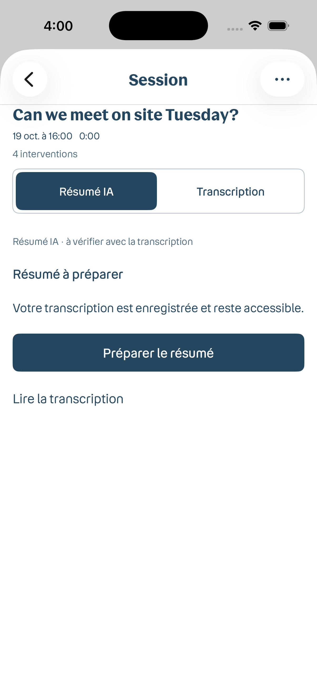

# AI summaries · separate draft feature

This feature is stacked after PR #4 (Relais design and local history) and PR #5 (Bouygues typography and compact bubbles). Neither earlier PR contains a summary UI, second model runtime, consent flow or generation entry point. Merge/review the earlier work independently; keep this PR in draft until device acceptance is complete.

## Scope

The existing summary implementation is preserved here: LFM2.5-1.2B-Instruct model loading, separate download consent, serialized translation/summary model handoff, bounded Unicode-safe excerpts, structured output/citation checks, saved summary state, retry/cancellation and transcript source links. Summary-specific runtime/cache changes and tests are isolated in this PR. Android's public SDK repository migration remains in PR #4 for build accessibility.

History-only schema v1 files omit summary metadata. Both platforms supply pending status and the current locale for missing fields when reading them, retaining IDs, titles, dates and original/translated turns. Upgrade tests cover reopening and a subsequent persisted rename.

## Preview

This is a fixture UI preview, not actual model output. No AI summary has been validated on a physical device.

## Validation boundary

The split passed an iOS Simulator build and 175 unit tests, plus 117 Android unit tests, a debug APK build, lint and instrumentation-source compilation. Tests use injected model runtimes. These checks cover persistence, migration, chunk completeness, citation/schema validation and lifecycle behavior; they do not establish real-model quality, memory use or offline acceptance.

Before leaving draft, validate on both iOS and Android devices:

- Real LFM output quality and citations against the full transcript, including longer bilingual sessions.
- Peak memory and serialized model load/unload while starting or ending conversations.
- First download, consent, interruptions, cold start and cached airplane-mode inference.
- Cancellation, backgrounding, retry, rename and deletion during generation.
- Android instrumentation/UI execution on a phone or emulator.

Long-session output accumulates excerpt summaries without a global synthesis pass, so points can repeat or miss connections across distant turns. Keep the verification notice visible and use the transcript as the source of record.
