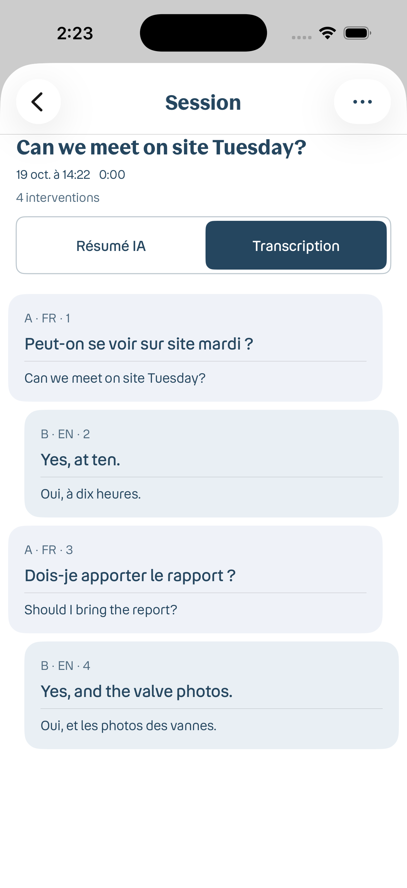

# Relais native design refinement

Stacked on PR #4 (`codex/relais-sessions`). This diff refines iOS and Android styling without changing speech, persistence or summary generation.

| Previous PR #4 preview | Updated iOS screen |
| --- | --- |
|  |  |

The previous capture is the minimal Hello / Bonjour fixture with English UI text. Updated French captures show two complete English/French exchanges (four alternating A/B turns) about a site visit and preparing a report and valve photos. All dialogue is illustrative fixture text; no model inference is exercised.

## Native adaptation

- Bouygues Speak headings/wordmark, Read Regular body and Read Medium emphasis. Identical TTFs are registered on iOS and bundled as Android font resources. Native Dynamic Type / sp scaling and fallback glyphs remain enabled.
- Translation stays first and bold, original stays visible below. Live and saved bubbles share 16pt radius/padding; controls use 8pt corners and full-width functional actions have a 48pt minimum height.
- 8pt spacing with 4pt compact increments; navy functional primary, outlined complementary actions, and redundant A/B speaker labels alongside color.
- Saved-session segments use navy selection and explicit selected accessibility traits on iOS. Android retains native tabs with the Trilogy typography/palette. Native system dialogs, keyboard and platform icons remain native.

## Validation

- iOS simulator build and 174 unit tests passed; 6 existing UI scenarios passed (header, save/history/transcript, control reachability, welcome, consent and typed input). The save/history scenario passed again after the final session heading and padding refinements.
- Unsigned iPhone Release build passed. Three font files were verified present in the built app and byte-identical to the Android resources.
- Android: 116 unit tests, debug APK build, lint, and instrumentation-test source compilation passed. No connected Android device/emulator was available, so Android UI tests were not executed.
- Native French conversation and saved-session screens inspected; accessibility-extra-large text checked for the translated/original text, language controls and A/B talk controls. Simulator text size restored afterward.
- `git diff --check` passed.

Actual summary output quality, peak memory, offline acceptance and physical-device inference remain unverified. The summary preview is only an interface state, not model validation. The existing internal iOS SDK deployment-target linker warning remains.

## Reproduce the representative captures

In a Debug simulator build, launch with `-uiState designConversation -firstRun returning -AppleLanguages '(fr)' -AppleLocale fr_FR`. This seeds four turns and consistent English/French language controls using ephemeral preferences. The new preview state and dialogue are excluded from Release. End → Save produces the matching four-turn saved session; no summary model is run. The existing single-turn UI test fixture stays unchanged.

The four-turn Debug build passed and all four translated/original turns were visually checked in the conversation and saved transcript. The main conversation and saved-session/transcript screenshots were replaced together.
